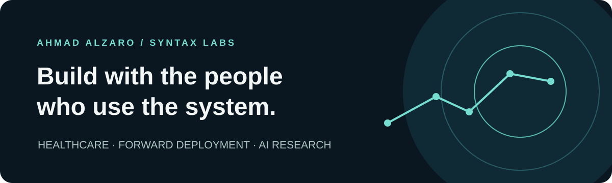

<h1 align="center">Ahmad Alzaro</h1>

<b>Forward-deployed AI engineering · Healthcare workflows · Research</b> Amman, Jordan · <a href="https://thesyntaxlabs.com">Syntax Labs</a>

I work alongside teams to understand their operations and build useful AI and digital systems. My work spans clinical workflows, staff enablement, operational data and language-model research.

## Healthcare and forward deployment

Through Syntax Labs, I work with healthcare practitioners and staff on patient coordination, operational workflows, AI adoption and training. My approach combines hands-on discovery, implementation, user support and attention to review and privacy.

### Surgical video intelligence

[Explore the research →](https://github.com/ahmadalzaro1/surgical-video-intelligence)  
Exploratory work on visualizing instrument tracking and video search using a public neurosurgical phantom dataset. This is research, not a clinical system.

## Selected AI research

### Arabic tokenization and representation

[Explore the project →](https://github.com/ahmadalzaro1/tokenization-shapes-embeddings)  
Research on how Arabic diacritics and tokenization choices affect learned representations. Findings should be read in the context of the experiment design and ongoing validation.

### Language-model behavior and safety

- [The Refusal Direction Generalizes](https://github.com/ahmadalzaro1/refusal-direction-generalizes) — a research study of refusal behavior in Gemma 2.
- [Antagonistic Attention](https://github.com/ahmadalzaro1/antagonistic-attention-bloom) — a preliminary mechanistic study of attention across six languages.

## Open source work

I like getting close to the tools I use: finding where things break, understanding why, and putting in the work to make them better. Here are some of the projects I've worked on.

### In the project's history

- **Hermes Agent** — Worked on recovery from temporary rate limits when an agent has only one credential. My [authored fix](https://github.com/NousResearch/hermes-agent/commit/dcd750434958d9ba55cb9c70567a17540c39f77c) is in the main branch's history. The related [pull request](https://github.com/NousResearch/hermes-agent/pull/53042) was closed without a recorded merge.

### Pull requests

- **Helix Foundry** — Built a local diagnostic to check compatibility between the backend and ontology agent. [#174 · Open](https://github.com/HelixDB/helix-foundry/pull/174)
- **Browser Harness** — Worked on opening the browser inspector in the Chromium browser a person is actually using on macOS. [#471 · Closed](https://github.com/browser-use/browser-harness/pull/471)
- **img2threejs** — Worked on enforcing visual-review checks in its 3D generation workflow. [#8 · Closed](https://github.com/img2threejs/img2threejs/pull/8)
- **HCW** — Built an integration for synchronizing consultation workflows with Odoo. [#2 · Closed](https://github.com/HCW-home/hcw/pull/2)
- **Hermes Agent** — Worked on [UTF-8 handling on Windows](https://github.com/NousResearch/hermes-agent/pull/51823), [context compression](https://github.com/NousResearch/hermes-agent/pull/51822), [Discord interactions](https://github.com/NousResearch/hermes-agent/pull/50714), [session continuity](https://github.com/NousResearch/hermes-agent/pull/50708), [long-session handoff](https://github.com/NousResearch/hermes-agent/pull/48485), and [MiniMax provider configuration](https://github.com/NousResearch/hermes-agent/pull/43023). These pull requests are closed without a recorded merge.

I've also documented issues in Hermes Agent around [credential recovery](https://github.com/NousResearch/hermes-agent/issues/53041), [macOS restarts](https://github.com/NousResearch/hermes-agent/issues/43475), [session continuity](https://github.com/NousResearch/hermes-agent/issues/43008), [provider configuration](https://github.com/NousResearch/hermes-agent/issues/42235), [context resets](https://github.com/NousResearch/hermes-agent/issues/36801), and the [desktop Sessions pane](https://github.com/NousResearch/hermes-agent/issues/73325).

## Connect

[Syntax Labs](https://thesyntaxlabs.com) · [LinkedIn](https://www.linkedin.com/in/ahmad-alzaro-jordan/)
